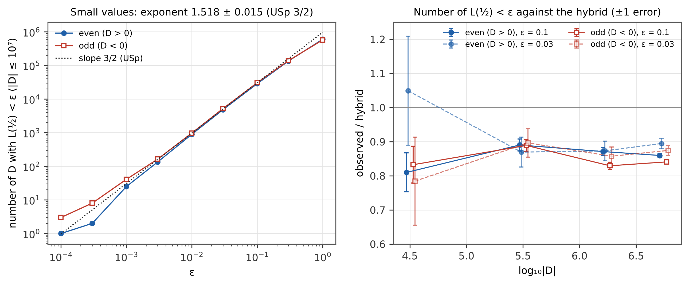
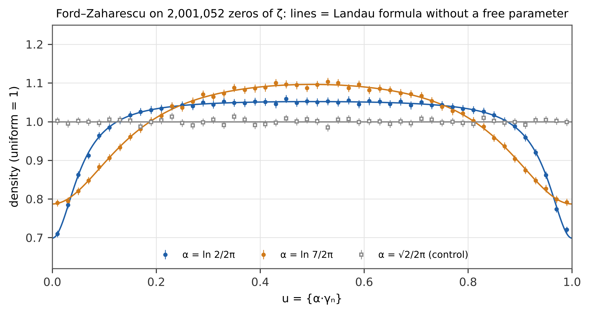

# 1. Introduction

Studies I–IV of this series [1–4] measured the statistics of the Riemann zeros at finite height and the low-lying zeros of 795,381 quadratic Dirichlet L-functions $L(s, \chi_D)$ against the ratios conjecture and the Katz–Sarnak limit. Study III found that families of consecutive discriminants behave differently from random samples of the same size, and that even characters ($D > 0$) carry a lower-order term in the distribution of the first zero. This study measures the values of the same L-functions at the central point $s = \tfrac12$ and connects them with their zeros.

The central values of the quadratic family are among the best studied objects of the theory. Conrey, Farmer, Keating, Rubinstein and Snaith (CFKRS) [5] conjectured the full asymptotics of the moments $\sum_D L(\tfrac12, \chi_D)^k$ as a polynomial $Q_k(\ln|D|)$ of degree $k(k+1)/2$; its leading coefficient is the random-matrix constant of Keating and Snaith [6] times an arithmetic factor. The first moments are theorems (Jutila [7] for $k = 1, 2$, Soundararajan [8] for $k = 3$ in the family $\chi_{8d}$); for $k = 3$ there is a secondary term of order $X^{3/4}$, predicted by Diaconu, Goldfeld and Hoffstein [9] and proved for a smoothed sum by Diaconu and Whitehead [10]. Alderson and Rubinstein [11] computed $L(\tfrac12, \chi_d)$ for $-5\cdot10^{10} < d < 1.3\cdot10^{10}$ and found agreement with CFKRS to 7–8 digits for $k = 1$; a first test of CFKRS cannot be claimed here, and our ranges are smaller than theirs. The distribution of $\ln L$ is Gaussian in the limit (Keating and Snaith [6]; Hough [12] under a hypothesis on low zeros), and finite conductor is described by hybrid models that combine an arithmetic factor with a random matrix (Gonek, Hughes and Keating [13]; Bui and Keating [14] for the symplectic family). The coupling of values and zeros enters through the ratios conjecture of Conrey, Farmer and Zirnbauer [15] in the form of Conrey and Snaith [16]: Fazzari [17] derived from it the one-level density of low-lying zeros weighted by $L(\tfrac12)^k$, with all lower-order terms; Sugiyama and Suriajaya [18] and Lesesvre and Suriajaya [19] studied related questions.

What we add is the joint data and a statistical framework. We have every fundamental discriminant up to $10^7$, three complete stretches of $1.2\cdot10^6$ discriminants at $10^8$, $4.9\cdot10^5$ at $10^9$ and $1.2\cdot10^5$ at $10^{10}$, and for 4.0 million of them the low zeros, so values and zeros of the same L-functions can be compared. Every comparison has an error and a null model, and most statements were tested against rules written before the computation (Section 3.6). Section 2 describes the data, Section 3 the methods, Section 4 the results: moments (4.1), consecutive families (4.2), the distribution of values (4.3), the first zero (4.4), hybrid products and the term $X^{3/4}$ (4.5), and the weighted density of low zeros (4.6), which follows the ratios conjecture for both signs after the correction of an error in our first implementation of the prediction. Section 5 lists the statements and their status, Section 6 separates what is new from what is confirmed, Section 7 discusses the limitations, Section 8 gives an outlook. The appendix is a calibration test on the zeros of $\zeta$.

# 2. Data

**Values.** $D$ runs over fundamental discriminants of both signs; $D > 0$ gives an even character, $D < 0$ an odd one. The central values were computed with PARI/GP 2.17.2 [20] (`lfun` at $s = \tfrac12$) by the script of study III, extended by a mode for the central value, on computer 2 (macOS, 9 processes); the blocks of values are stored with their SHA-256 checksums. Table 1 lists the families. The set V5 ∪ V10 contains every fundamental discriminant with $3 \le |D| \le 10^7$: an independent sieve finds exactly 6,079,285, and every one occurs once. B10, C100 and R10 are subsets of it (the families of study III), D100 lies at $10^8$. The stretches D100b and D100c continue D100 without gaps. At $10^{10}$ (families E10 and E100 of study III) a value from PARI takes too long; we evaluated our own smoothed approximate functional equation with Taylor weights for all 121,557 discriminants and checked it below. The same functional equation gave the values of the family S9L at $10^9$ (every fundamental discriminant with $10^9 < |D| \le 10^9 + 8\cdot10^5$, 486,344 values), which was added after the correction of Section 4.6 to fill the gap between $10^8$ and $10^{10}$.

| family | discriminants | L-functions | values | zeros |
|------|------|-------:|------|------|
| V5 ∪ V10 | every $3 \le |D| \le 10^7$ | 6,079,285 | PARI | — |
| B10 | $10^4 < |D| \le 10^5$ (in V) | 54,700 | PARI | study III |
| C100 | $10^6 < |D| \le 2\cdot10^6$ (in V) | 607,941 | PARI | study III |
| R10 | 60,000 random, $10^6 \le |D| < 10^7$ (in V) | 60,000 | PARI | study III |
| S7 | $7.5\cdot10^6 < |D| \le 10^7$ (in V) | 1,519,830 | PARI | this study (6,592,004) |
| D100 | $10^8 < |D| \le 10^8 + 10^5$ | 60,802 | PARI | study III |
| D100b | $10^8 + 10^5 < |D| \le 10^8 + 10^6$ | 547,116 | PARI | this study (2,366,952) |
| D100c | $10^8 + 10^6 < |D| \le 10^8 + 2\cdot10^6$ | 607,921 | PARI | this study (2,630,285) |
| S9L | $10^9 < |D| \le 10^9 + 8\cdot10^5$ | 486,344 | own functional equation | this study (2,099,543) |
| E10 ∪ E100 | $10^{10} < |D| \le 10^{10} + 2\cdot10^5$ | 121,557 | own functional equation | study III (523,633) |

*Table 1. Families. In total 7,903,025 distinct central values and 4,042,611 distinct discriminants with zeros (R10 is a random sample and shares 6,740 discriminants with C100 and 16,860 with S7). Even and odd characters are about equally frequent in every family (|D| ≤ $10^7$: 3,039,653 and 3,039,632).*

**Checks of the values.** (i) An independent smoothed approximate functional equation $L(\tfrac12, \chi_D) = 2\sum_n \chi_D(n) n^{-1/2}\,\Gamma(c, \pi n^2/|D|)/\Gamma(c)$, $c = \tfrac14$ or $\tfrac34$, with our own Kronecker symbol, agrees on 1,220 values drawn from all families (and the 20 smallest values) to $5.3\cdot10^{-14}$, and on 2,020 values of D100b and D100c to $8.6\cdot10^{-14}$. (ii) The same 1,220 values in mpmath with 30 significant digits differ from PARI by at most $4.8\cdot10^{-15}$ relatively (median $6.5\cdot10^{-16}$), 200 values at $10^8$ by at most $3.8\cdot10^{-15}$. (iii) At $10^{10}$ PARI agrees with our functional equation on 24 discriminants to $9.1\cdot10^{-13}$; following a rule fixed beforehand (relative difference below $10^{-9}$), computer 2 then computed the whole band E10 with PARI (12,153 values, 1,000 blocks with SHA-256): largest relative difference $4.3\cdot10^{-11}$, median $2.1\cdot10^{-14}$. (iv) At $10^9$, under the same rule recorded beforehand, computer 2 computed 2,000 random discriminants of S9L with PARI (40 blocks with SHA-256): largest relative difference $8.4\cdot10^{-13}$, median $2.5\cdot10^{-15}$. (v) No value is zero or negative.

**Zeros.** The low zeros of B10, C100, R10, D100 and E come from study III (computed with PARI `lfunzeros` up to the unfolded height 4.3). For this study computer 2 computed the zeros of D100b (7.0 hours, 450 blocks) and D100c (8.2 hours, 500 blocks) with the same script (SHA-256 of the script `2006a966…`) and, after the correction of Section 4.6, the zeros of S7 (6.1 hours, 1,250 blocks) and of S9L (19.7 hours, 1,600 blocks; both with the script `1b53fe0e…`, the same computation with further families defined); the SHA-256 of all 3,800 blocks agree with the manifests, every discriminant has a value and at least one zero. The zeros are not part of the publication; the script, the manifests and the checksums are.

# 3. Methods

## 3.1 The CFKRS polynomials

For fundamental discriminants of one sign the recipe of CFKRS [5] gives the mean of $L(\tfrac12, \chi_D)^k$ as $Q_k(\ln|D|)$, a $k$-fold contour integral of $\prod_{i \le j}\zeta(1 + z_i + z_j)$ times an arithmetic factor (the density of $p \nmid D$ among fundamental discriminants is $p/(p+1)$, also for $p = 2$) and the factor $X(\tfrac12 + z, a) = \pi^{z}\Gamma((\tfrac12 - z + a)/2)/\Gamma((\tfrac12 + z + a)/2)$, $a = 0$ for even and $a = 1$ for odd characters. We evaluate the integral by the trapezoidal rule on tori of radii 0.15–0.31 (primes up to $10^5$ in the arithmetic factor and an integral for the tail). Checks: for $k = 1$ the polynomial is known in closed form, $Q_1 = A_0[(\ln(|D|/\pi) + \psi(c))/2 + 2\gamma] + A'$ with $A_0 = 0.7044422$, and the contour reproduces it to $2.5\cdot10^{-8}$; the leading coefficients equal the Keating–Snaith constant $a_k\prod_{j<k} j!/(2j)!$ to $10^{-6}$ for $k \le 4$ and $1.3\cdot10^{-5}$ for $k = 5$; and our polynomials reproduce the predicted values in the tables of Alderson and Rubinstein [11] (both signs, $k = 1$–$5$, up to $X = 5\cdot10^{10}$) to $6.5\cdot10^{-8}$.

## 3.2 Errors and null models

Means over a band of $|D|$ are compared with the mean of $Q_k(\ln|D|)$ over the same discriminants. The error is taken from the scatter of the sums over blocks of 20,000 consecutive $|D|$ ("error from blocks"); for the samples R10 and D100 we use the error of independent values. Section 4.2 shows that the sums over consecutive blocks are anticorrelated, so the error from blocks overestimates the error of the total. Null models are the leading term alone, random subsets of the same size, and — for statements about zeros — the values shuffled among the discriminants.

## 3.3 Random matrices

For USp$(2N)$ we use the characteristic polynomial $\Lambda(1)$ and the first eigenangle. Its moments and the distribution of $\ln\Lambda$ are exact (Keating–Snaith [6], via the Barnes function); joint quantities are sampled exactly (determinantal point process with the sine basis, 40,000 matrices for $N = 1$–11), and the weighted first eigenangle is computed from the Jacobi ensemble with weight $(1 - x)^{k + 1/2}(1 + x)^{1/2}$. The size $N$ is fixed without a free parameter in three ways: $N_{k1}$ from the first moment ($a_1 E_{\mathrm{USp}}[\Lambda] = Q_1$), $N_{x_1}$ from the mean first zero, and $N_{\mathrm{eff}}$ from the ratios conjecture (agreement of the one-level density with lower-order terms near $x = 0$, as in study III).

## 3.4 Hybrid model for $\ln L$

$\ln L(\tfrac12, \chi_D) = \ln a + \ln\Lambda_{\mathrm{USp}(2N)}$, where the cumulants of the arithmetic part come from the arithmetic factor of the moments ($\kappa_1 \dots \kappa_4 = -0.209, -0.289, 0.242, -0.794$) and $N = N_{k1}$. The model has no free parameter. The negative $\kappa_2$ shows that the arithmetic part is not an independent random variable; the hybrid is a statement about cumulants.

## 3.5 Weighted one-level density

For a set of discriminants we compare the density of the unfolded zeros $x = \theta_D(\gamma)/\pi$ in five bins of width 0.2 on $[0, 1]$, weighted by $L(\tfrac12, \chi_D)$, with the unweighted density; the statistic is the difference of the two. The prediction is Fazzari's formula [17, eq. (4.8)] from the ratios conjecture with the arithmetic factor $A(\alpha, \beta; D)$ and its derivative, evaluated for both signs with the corresponding $\Gamma$-factor and averaged over 20 bins of the conductor $l = \ln(|D|/\pi)$; the limit $\alpha \to 0$ is taken as a mean over a circle (we checked that it does not depend on the radius). An independent implementation (Section 4.6, `code/weighted_density_independent.py`) sums the local factors numerically, takes the derivative by a central difference and the limit $\alpha \to 0$ by Richardson extrapolation, and averages over 40 bins of $l$; after the correction described in Section 4.6 the two agree to $3\cdot10^{-5}$. The same recipe gives the unweighted density and $\langle L(\tfrac12)\rangle$, which agree with the data and with $Q_1$ to four digits. The error of a bin is the larger of a bootstrap (300 resamplings) and the scatter of 200 runs with the values shuffled among the discriminants; the shuffled runs have mean zero. To compare with the erroneous first implementation (Section 4.6) we project the residual on the shape of its former deviation in C100 (even characters) and call the coefficient the amplitude ($= 1$ for C100 with the erroneous prediction).

## 3.6 Rules recorded beforehand

The laboratory used for this work (a development tool, not part of the publication) states every hypothesis with a verdict rule — SUPPORTED, REJECTED or UNDECIDED — and a null model. For the steps 34.77–34.85 the rules were written before the computation (the rules for the families S7 and S9L after the error of Section 4.6 had been found and before their zeros were computed); for 34.76 after a first look at the data, and four hypotheses were added after the first numbers were seen; we mark these as post hoc. The rules are part of the repository. Section 5 reports the verdicts and the rejected statements as well.

# 4. Results

## 4.1 Moments $k = 1$–$5$

Over all $|D| \le 10^7$ the moments agree with the CFKRS polynomials far below the error (Table 2). In seven bands of $|D|$ from $3$ to $10^7$, for both signs and $k = 1$–$5$ (70 combinations), the largest deviation is 0.65 errors (Figure 1, left); the random sample R10 deviates by at most 1.9 errors of independent values ($k = 5$, odd), D100 by at most 0.8. At $10^8$ (D100b ∪ D100c, 1,155,037 values) the relative differences are $-4.1\cdot10^{-5}$ ($k = 1$) to $-4.5\cdot10^{-3} \pm 7.9\cdot10^{-3}$ ($k = 5$) for even characters and $-8.8\cdot10^{-5}$ to $-2.7\cdot10^{-3} \pm 1.2\cdot10^{-2}$ for odd ones, at most 0.57 errors. At $10^9$ (S9L, 486,344 values) a descriptive comparison by the same procedure, for which no rule was recorded, gives relative differences from $+1.0\cdot10^{-4}$ ($k = 1$) to $+4.2\cdot10^{-3} \pm 1.7\cdot10^{-2}$ ($k = 5$) for even characters and from $+3.7\cdot10^{-4}$ to $-2.6\cdot10^{-2} \pm 2.3\cdot10^{-2}$ for odd ones, at most 1.15 errors.

| $k$ | even: data/CFKRS − 1 | error | odd: data/CFKRS − 1 | error | leading term alone, even / odd |
|---|------:|------:|------:|------:|------:|
| 1 | $+7.9\cdot10^{-6}$ | $7.1\cdot10^{-5}$ | $-6.0\cdot10^{-7}$ | $8.2\cdot10^{-5}$ | $-9.2$ % / $+12$ % |
| 2 | $+2.8\cdot10^{-5}$ | $1.9\cdot10^{-4}$ | $+3.5\cdot10^{-6}$ | $2.4\cdot10^{-4}$ | $+22$ % / $+108$ % |
| 3 | $+3.5\cdot10^{-5}$ | $4.0\cdot10^{-4}$ | $-1.5\cdot10^{-5}$ | $6.3\cdot10^{-4}$ | ×4.6 / ×11.7 |
| 4 | $+6.8\cdot10^{-6}$ | $7.6\cdot10^{-4}$ | $-1.1\cdot10^{-4}$ | $1.3\cdot10^{-3}$ | ×85 / ×323 |
| 5 | $-7.0\cdot10^{-5}$ | $1.3\cdot10^{-3}$ | $-3.1\cdot10^{-4}$ | $2.2\cdot10^{-3}$ | ×11,000 / ×64,000 |

*Table 2. Moments over all $3 \le |D| \le 10^7$ (3,039,653 even, 3,039,632 odd). Error from blocks of 20,000 (Section 3.2). Last column: data relative to the leading term alone (Keating and Snaith with the arithmetic factor).*

{width=100%}

The lower-order terms of the polynomial are essential: the leading term alone is 9 % off at $k = 1$ and a factor $10^4$ at $k = 5$. The difference of the first moments of the two signs is a clean consequence of the $\Gamma$-factors, $A_0(\psi(\tfrac34) - \psi(\tfrac14))/2 = A_0\pi/2 = 1.10654$; the data give $1.10649 \pm 0.00060$.

## 4.2 Consecutive families

The error from blocks is smaller than the error of independent values by factors 0.11–0.33 for $k = 1$–4 and 0.31–0.42 for $k = 5$, whereas random subsets of the same size scatter like independent values (0.94–1.04). Sums of $L(\tfrac12, \chi_D)^k$ over a block of 20,000 consecutive $|D|$ thus vary three to nine times less than over the same number of random discriminants. Over the whole range the cumulative sum of the residuals has a root-mean-square size of only 0.008–0.028 of a random walk of independent values — in line with the observation of Alderson and Rubinstein that the remainder of the first moment grows only like $X^{1/4+\varepsilon}$ [11].

The effect grows with the width $w$ of the block (Figure 2, left): for $k = 1$ and even characters the ratio falls from 0.48 at $w = 100$ to 0.27 at $w = 10^3$, 0.15 at $10^4$ and 0.062 at $10^5$. At $10^8$ the same width cancels less (12 of 12 comparisons at $w = 500$–2,000). The mechanism is the periodicity of $\chi_D(n)$ in $D$: in the approximate functional equation the terms with $n$ up to about $\sqrt{|D|}$ contribute, $\chi_D(n)$ is periodic in $D$ with period $n$ (or $4n$), and a block of width $w$ averages the terms with $n \lesssim w$ over complete periods. The cancellation is not complete because the condition "fundamental" is not periodic. It is the same effect of consecutive families that study III found in the low-frequency power of the zeros.

{width=100%}

How does the effect depend on $|D|$? Two rules recorded beforehand were rejected. Scaling with $w/\sqrt{|D|}$ (the length of the functional equation) fails by up to 25 errors: a band near $2\cdot10^6$ cancels less than one at $10^8$ with the same $w/\sqrt{|D|}$; $w$ alone gives the opposite sign ($-2.9$ to $-13.7$ errors) and $w/|D|$ is far off. The exponent $\alpha$ that matches the two bands is 0.16–0.39 and grows with $w$ (Figure 2, right). Scaling with the logarithmic variable $u = \ln w/\ln\sqrt{|D|}$ fails as well (14 of 16 comparisons differ by more than two errors, up to 15.9): the bands match for $u_B \approx 0.87$–$0.99\,u_A$, which points to an effective length of the functional equation somewhat larger than $\sqrt{|D|}$. At $10^8$ and $w = 10^5$ the ratio is 0.09–0.14 (19 blocks). A quantitative law for the cancellation remains open; for the moments it means that the error from blocks of a consecutive family is conservative.

## 4.3 The distribution of values

**Hybrid model.** The variance of $\ln L$ agrees with the hybrid of Section 3.4 to 0.26 % in the three bands with $|D| \ge 10^5$ (0.3–2.1 errors; the error from blocks is 0.11–0.64 %), for both signs, without a free parameter. Higher cumulants deviate (Figure 3, left): for $|D| \ge 10^6$ the mean of $\ln L$ lies 0.017–0.023 below the hybrid and the third cumulant is 4–7 % less negative (1.4–12.4 errors; rejected by the rule recorded beforehand). With $2N = \ln(|D|/\pi)$ for both signs, as in the original model of Keating and Snaith, the prediction falls between the signs.

**Fractional moments.** $E[L^{1/2}]$ and $E[L^{-1/2}]$ for $10^6 \le |D| \le 10^7$ lie about 1 % from the hybrid ($-1.00, -0.76, -0.93, -0.73$ % and $+0.94, +0.69, +0.88, +0.66$ %, even/odd and two bands); the rule "within 1 %" was missed narrowly. Followed to $10^8$, the deviation falls monotonically in all four series (even, $s = \tfrac12$: $-1.13$ % at $10^5$–$10^6$, $-1.00$, $-0.93$, $-0.80$ % at $10^8$), and a fit $a + b/\ln|D|$ gives asymptotes $-0.09 \pm 0.23$, $+0.10 \pm 0.38$, $-0.26 \pm 0.21$ and $-0.03 \pm 0.43$ % — compatible with zero, as for a lower-order term (Figure 3, right). The rule recorded beforehand required a decrease of more than three errors between $10^6$–$10^7$ and $10^8$; it reached 0.5–2.4, so the statement is undecided.

![Figure 3. Left: mean, variance and third cumulant of $\ln L(\tfrac12)$ against the hybrid model, by bands of $|D|$. Right: fractional moments $E[L^{\pm1/2}]$ against the hybrid as a function of $1/\ln|D|$ ($\pm 2$ errors), with linear fits; the right-most points are the smallest $|D|$, the left-most $10^8$.](../figures/03_log_values_en.png){width=100%}

**Small values.** For random matrices $E[\Lambda^s]$ has its first pole at $s = -\tfrac32$, so $P(\Lambda < \varepsilon) \propto \varepsilon^{3/2}$. The maximum-likelihood exponent of the values below 0.03 is $1.518 \pm 0.015$ ($1.525 \pm 0.022$ even, $1.511 \pm 0.021$ odd; Figure 4, left). The number of values below $\varepsilon$ is 11–17 % smaller than the hybrid predicts for $|D| \ge 10^6$ at $\varepsilon = 0.1$ and 0.03 (Figure 4, right), the same in all nine classes of $(\chi_D(2), \chi_D(3))$ ($\chi^2 = 41.4$ for 32 degrees of freedom, $p = 0.12$), although the classes differ enormously in their number of small values (4,161 values below 0.03 for $\chi_D(2) = \chi_D(3) = -1$ against 21 for $+1, +1$, both signs, $|D| \ge 10^6$), as their arithmetic factors predict.

{width=100%}

**Non-vanishing.** No central value is zero: the smallest is $6.04\cdot10^{-5}$ at $D = -115{,}147$ (a known example; Watkins, quoted by Stopple [21]), 66 values lie below $10^{-3}$. At $10^8$ and $10^{10}$ the smallest values are $2.0\cdot10^{-4}$ and $2.8\cdot10^{-4}$.

## 4.4 The central value and the first zero

The central value and the first zero $x_1$ (unfolded by $\theta_D$ as in study III) are strongly coupled: $\mathrm{corr}(\ln L, x_1) = 0.83$–0.89 in the eight groups (four families, two signs), and the mean value of $L$ grows from about 0.7–1.0 in the lowest fifth of $x_1$ to 7.5–19 in the highest. Shuffling gives $0.000 \pm 0.006$. USp$(2N_{k1})$ gives 0.81–0.89, and the data lie above it in seven of the eight groups, by up to 17 errors (Figure 5, left); the mean first zero is lower than USp$(2N_{k1})$ (0.62–0.69 against 0.69–0.74). Both statements were rejected; the excess is not carried by the small primes — inside the classes of $\chi_D(2), \chi_D(3), \chi_D(5)$ the distance from USp grows rather than shrinks.

With $N_{\mathrm{eff}}$ from the ratios conjecture (no free parameter) the picture changes: $N_{\mathrm{eff}}$ equals the size $N_{x_1}$ that matches the mean first zero almost exactly (1.98 against 2.00 in B10 even, …, 3.88 against 3.88 in D100 odd), so the mean first zero is a finite-size effect that the ratios conjecture explains (within 3.2 errors except C100 even, 6.9). What remains is the shift of the first zero under weighting by $L(\tfrac12)$: in the data it is 9–16 % larger than in USp$(2N_{\mathrm{eff}})$ weighted by $\Lambda(1)$ (8–42 errors; Figure 5, right). The excess coupling of value and zero is therefore not an effect of a finite matrix size; the weighted density of the ratios conjecture describes it for both signs (Section 4.6).

{width=100%}

Small values and low zeros come together as random matrices predict. Hough [12] showed that the logarithm of $L(\tfrac12, \chi_{8d})$ is Gaussian provided low zeros are rare; in our data $P(L < 0.03 \mid x_1 < 0.2)/P(L < 0.03) = 27$–44 in the eight groups, and USp$(2N_{x_1})$ with matched quantiles gives 32–42 (at most 1.0 errors; shuffled values give 1).

## 4.5 Hybrid products and the term $X^{3/4}$

**Splitting conjecture.** Gonek, Hughes and Keating [13] and Bui and Keating [14] write $L$ as a product $P_X Z_X$ of a short Euler product and a product over zeros, and conjecture that the moments split, $E[L^k] \approx E[P_X^k]E[Z_X^k]$, asymptotically. With the truncated Euler product the ratio $S_k = E[L^k]/(E[P_X^k]E[Z_X^k])$ is far from 1 ($S_1 = 0.80$ at $X = 10$; rejected). With $P_X$ in the form of Bui and Keating ($\exp\sum_{n \le X}\Lambda(n)\chi(n)/(\sqrt n\ln n)$) $S_k$ approaches 1 with the conductor in all four series (supported): $S_1$ for even characters 0.863 ($10^5$–$10^6$), 0.897 ($3\cdot10^6$–$10^7$), 0.926 ($10^8$), for odd characters 0.904, 0.928, 0.949; $S_2$ 0.50 → 0.58 → 0.65 and 0.59 → 0.66 → 0.72. The moments of $Z_X$ against USp$(2N)$ with $N = \ln|D|/(2e^\gamma\ln X)$ (1.5–3.2) agree for odd characters at $k = 1$ (ratio 0.94–1.10) but not for even ones (0.49–0.96); the statement was rejected. (The rule recorded beforehand took $N = \ln|D|/(e^\gamma\ln X)$, which in [14] is the matrix size $2N$; with the correct $N$ the conclusion stays.)

**The term $X^{3/4}$.** For $k = 3$ the running sum of the residuals divided by $X^{3/4}$ gives for even characters $b = -0.248 \pm 0.038$ — 6.6 errors from zero and 2.9 from the value $b_+ \approx -0.14$ computed by Zhang and quoted in [11] — and for odd characters $-0.219 \pm 0.130$, not resolved. In the subfamily $D = 8d$ of Diaconu and Whitehead [10], with their smoothing, the signal is $-28$ against a scatter of about 200 between windows, and $b = -0.26 \pm 0.21$; both statements are undecided. The CFKRS polynomial of the subfamily (with the factor at 2) agrees with the smoothed sum to $5\cdot10^{-5}$, and consecutive windows again scatter 31 times less than independent ones.

## 4.6 The weighted density of low zeros

Weighting the zeros by $L(\tfrac12, \chi_D)$ pushes them away from the central point. Pure USp$(2N_{x_1})$ fails in every family ($\chi^2$ = 82–1,811 for five bins). The ratios conjecture with weight $L(\tfrac12)$ (Fazzari [17]) describes both signs in every family (Figure 6): with the larger of both errors, $\chi^2$ for five bins is 0.63, 1.76, 0.87 and 4.31 for even characters in B10, C100, R10 and D100 and 0.52–1.26 for odd ones; at $10^8$ (D100 ∪ D100b ∪ D100c, 1,215,839 L-functions) it is 2.25 and 0.72, at $10^{10}$ (E, 121,557 L-functions) 1.51 and 0.88; in the families computed after the correction (below), 0.21 and 0.64 (S7) and 1.75 and 1.31 (S9L at $10^9$); the smallest $p$ of the twenty groups is 0.51. All these $\chi^2$ lie below the number of bins (mean 1.3): the error is cautious, because we take the larger of two estimates and because averages over consecutive families scatter less than over random samples (Section 4.2). In a descriptive test on 20 pieces of S7 the mean $\chi^2$ of a piece is 1.2 (even) and 1.9 (odd) for consecutive pieces and 3.2 and 2.4 for random ones; with the bootstrap error alone it is 2.0 and 4.2 against 6.1 and 5.1, where 5 is expected. The test is therefore conservative and its $p$-values are only indicative; that it discriminates nevertheless is shown by the erroneous prediction ($\chi^2$ up to 285, below). The shuffled values give zero, and the unweighted density and $\langle L(\tfrac12)\rangle$ from the same recipe agree with the data for both signs.

{width=100%}

**A correction before publication.** Our first implementation of this prediction (laboratory steps 34.79–34.84) contained an error: in the term of the recipe with both swaps $\alpha \to -\alpha$, $\beta \to -\beta$ it used the factor $X(\tfrac12 + \alpha + \beta)$ instead of $X(\tfrac12 + \alpha)X(\tfrac12 + \beta)$. The error changes the prediction for odd characters only slightly (at most 0.5 errors of the data) but for even ones strongly, and it decreases with the conductor. With it the even data seemed to carry an extra term ($\chi^2$ = 202 in B10 and 285 in C100) whose amplitude fell roughly like $|D|^{-1/4}$; a scaling law and a replication on new discriminants at $10^8$ were recorded beforehand and passed — tested against an error of the prediction, not against a property of the zeros. A second implementation, written for the classes of $\chi_D(2)$ from the first one, shared the error, which is why the two agreed. Before publication we wrote an independent implementation under a rule recorded beforehand: the local factors as numerically summed series instead of closed forms, the Euler product to $5\cdot10^5$, the derivative in $\beta$ by a central difference and the limit $\alpha \to 0$ by Richardson extrapolation. It differed from the first one by up to 13.3 errors for even characters, which led to the faulty factor; after correcting this single factor the first implementation agrees with the independent one to 0.005 errors (absolute $3\cdot10^{-5}$). Figure 7 shows the apparent term and its disappearance: on the shape of the former deviation the even amplitudes are now $0.065 \pm 0.059$ (C100), $-0.038 \pm 0.050$ (all three families at $10^8$) and $0.08 \pm 0.19$ (E), all zero within the errors.

{width=100%}

**A family computed after the correction.** Once the error was found, and before any new data, we recorded one more rule: the corrected prediction has to describe, for both signs and with $p > 0.001$ for five bins, a family that had not been analysed so far. Computer 2 then computed the zeros of every fundamental discriminant with $7.5\cdot10^6 < |D| \le 10^7$ (S7: 1,519,830 L-functions, 6,592,004 zeros; 16,860 of these discriminants also belong to the random sample R10). The corrected prediction gives $\chi^2 = 0.21$ for even and $0.64$ for odd characters ($p = 0.999$ and $0.986$), and the amplitude on the shape of the former deviation is $0.015 \pm 0.040$. The erroneous first implementation would have given $\chi^2 = 240.7$ and the amplitude $0.62$ for even characters — what the scaling law fitted with it had predicted for this family ($0.608 \pm 0.045$, recorded before the error was known). A prediction recorded beforehand thus protects against a flexible analysis, not against an error shared by the prediction and the analysis; with the corrected prediction the amplitude lies 9.8 errors below that expectation.

**The point at $10^9$.** To fill the gap between $10^8$ and $10^{10}$, computer 2 then computed, under the same rule (recorded before the data together with the other decisions for this family), the zeros of every fundamental discriminant with $10^9 < |D| \le 10^9 + 8\cdot10^5$ (S9L: 486,344 L-functions, 2,099,543 zeros, 19.7 hours); the central values come from our functional equation and were released for the analysis only after the check against PARI of Section 2 had passed. The corrected prediction gives $\chi^2 = 1.75$ for even and $1.31$ for odd characters ($p = 0.883$ and $0.934$), and the amplitude on the shape of the former deviation is $-0.088 \pm 0.084$. The erroneous first implementation would have given $\chi^2 = 4.7$ and the amplitude $0.13$ for even characters; the two amplitudes differ by 2.6 errors. A hypothesis for this point had been recorded before the error was known (the amplitude $0.164 \pm 0.040$ expected from the scaling law fitted with the erroneous prediction); with the corrected prediction its rule cannot separate that value from zero at the present error (they lie less than two combined errors apart). The measured amplitude lies 2.7 combined errors below the expected value; the formal outcome of the rule (UNDECIDED) is reported for the record only and is not interpreted. The explicit formula was not evaluated on S9L: its prime side would run up to $n \le |D|/\pi \approx 3.2\cdot10^8$ (decided beforehand).

**Explicit formula.** As a check that does not use the ratios conjecture we evaluated the explicit formula on C100 with the test function $\varphi(u) = (\sin(\pi u/2)/(\pi u/2))^4$, $u = \gamma\ln(|D|/\pi)/2\pi$, whose Fourier transform has support $|\nu| \le 1$, so the prime side ends at $n \le |D|/\pi$ (the conventions were checked on single L-functions with zeros from PARI up to $u = 40$, to $10^{-6}$). On every L-function the zero side (zeros of study III, the part above the computed zeros from the smooth density) and the prime side (characters, $\Lambda(n)$ and the $\Gamma$-term) agree to a median of $7\cdot10^{-5}$. For the weighted minus unweighted family averages the zero side is $-0.36855 \pm 0.00073$ (even) and $-0.45488 \pm 0.00096$ (odd); with the part above the computed zeros taken from the densities of the ratios conjecture, as the rule recorded beforehand prescribed, zero side and prime side agree to 2.2 and 1.6 paired errors (with the smooth density alone to 5.1 and 9.0, a difference of $2\cdot10^{-5}$). The prime side splits (Figure 8) into $p = 2$ ($-0.091$ / $-0.095$), odd $p \le \sqrt{|D|/\pi}$ ($-0.271$ / $-0.331$), odd $p > \sqrt{|D|/\pi}$ ($+0.019$ / $-0.002$) and prime powers ($-0.025$ / $-0.027$). With the same smooth test function the corrected prediction differs from the zero side by $-0.09$ and $-0.04$ errors. On S7 (759,933 + 759,897 L-functions) the zero side is $-0.38687 \pm 0.00052$ (even) and $-0.46553 \pm 0.00060$ (odd), zero side and prime side agree to 2.0 and 0.1 paired errors, and the corrected prediction differs from the zero side by $-0.12$ and $-0.12$ errors. The paired error is here only $4.4\cdot10^{-7}$ and $1.3\cdot10^{-6}$, so the part above the computed zeros matters: the explicit formula requires $2.35\cdot10^{-5}$ and $3.13\cdot10^{-5}$ for it, and the densities of the ratios conjecture give $2.26\cdot10^{-5}$ and $3.14\cdot10^{-5}$.

{width=100%}

# 5. Statements and their status

| statement | status |
|--------------------------------------------------|------------------------------------------|
| The moments $k = 1$–$4$ of both signs follow the full CFKRS polynomials [5] up to $10^7$. | Known conjecture, tested before up to $|d| \approx 5\cdot10^{10}$ [11]; consistent here in 56 bands and the samples (rule: SUPPORTED). |
| The fifth moment follows CFKRS. | Consistent: 14 bands, $\le 0.63$ errors (SUPPORTED). |
| The moments follow CFKRS at $10^8$ ($k = 1$–5). | Consistent: $\le 0.57$ errors (SUPPORTED). |
| The leading term of Keating and Snaith alone describes the moments to 10 %. | Rejected: 9 % at $k = 1$ to a factor $6\cdot10^4$ at $k = 5$. |
| The difference of the first moments of odd and even characters is $A_0\pi/2$. | Consistent: $1.10649 \pm 0.00060$ against 1.10654 (SUPPORTED). |
| Sums over blocks of consecutive discriminants scatter like random samples. | Rejected: 0.11–0.42 of random samples. |
| The cancellation grows with the width of the block and is weaker at larger $|D|$. | Consistent (SUPPORTED; post hoc). |
| The cancellation depends on $|D|$ only through $w/\sqrt{|D|}$, or through $\ln w/\ln\sqrt{|D|}$. | Rejected: up to 25 and 15.9 errors; effective exponent 0.16–0.39. |
| The variance of $\ln L$ follows the hybrid model to 1 %. | Consistent: 0.26 % (SUPPORTED). |
| The third cumulant and the fractional moments $E[L^{\pm1/2}]$ follow the hybrid. | Rejected: 4–7 % and about 1 %. |
| The deviation of the fractional moments falls like $1/\ln|D|$ to zero. | Undecided: falls monotonically to $10^8$, asymptote 0 within errors, decrease 0.5–2.4 errors (rule: 3). |
| $P(L < \varepsilon) \propto \varepsilon^{3/2}$. | Consistent: $1.518 \pm 0.015$ (SUPPORTED; post hoc). |
| The deficit of small values against the hybrid is the same in all classes of $\chi_D(2)$, $\chi_D(3)$. | Consistent: $p = 0.12$ (SUPPORTED). |
| No $L(\tfrac12, \chi_D)$ vanishes for $|D| \le 10^7$. | Consistent: smallest $6.04\cdot10^{-5}$ (SUPPORTED). |
| The correlation of $\ln L$ with the first zero and the mean first zero follow USp$(2N_{k1})$. | Rejected: up to 17.7 and 42 errors. |
| The excess correlation is carried by the small primes. | Rejected. |
| $N_{\mathrm{eff}}$ from the ratios conjecture explains the first zero and its shift under weighting by $L(\tfrac12)$. | Partly: the mean first zero yes, the shift no (9–16 % above; REJECTED). |
| Small values and low zeros come together as in USp$(2N_{x_1})$. | Consistent: ratio 27–44 against 32–42 (SUPPORTED). |
| The moments split into $P_X$ and $Z_X$ (Bui–Keating). | Consistent with a slow approach to 1 (SUPPORTED); the truncated product is rejected. |
| The moments of $Z_X$ follow USp$(2N)$ with $N = \ln|D|/(2e^\gamma\ln X)$. | Rejected for even characters (0.49–0.96). |
| A term $bX^{3/4}$ is visible in the third moment up to $10^7$. | Undecided: even $-0.248 \pm 0.038$, odd not resolved; subfamily $8d$: $-0.26 \pm 0.21$. |
| The weighted density of low zeros follows the ratios conjecture with weight $L(\tfrac12)$ [17]. | Consistent for both signs at all conductors, $\chi^2$ 0.2–4.3 for five bins (SUPPORTED after the correction of Section 4.6; with the erroneous first implementation even characters were rejected up to $10^8$). |
| The corrected prediction describes a family computed after the correction (S7; rule recorded before its data). | Consistent: $\chi^2$ 0.21 and 0.64, $p$ 0.999 and 0.986 (SUPPORTED). |
| The corrected prediction describes the family at $10^9$, computed after the correction (S9L; rule recorded before its data). | Consistent: $\chi^2$ 1.75 and 1.31, $p$ 0.883 and 0.934 (SUPPORTED). |
| An independent implementation reproduces our first implementation of the prediction. | Rejected: up to 13.3 errors for even characters; the faulty $\Gamma$ factor was found and corrected, afterwards agreement to 0.005 errors. |
| Even characters carry an extra term in the weighted density that falls like $|D|^{-\theta}$ and replicates at $10^8$. | Rejected after the correction: amplitudes zero within the errors at every conductor (the earlier SUPPORTED verdicts rested on the erroneous prediction). |
| The explicit formula balances the zero side and the prime side of the weighted family averages. | Consistent on C100 (2.2 and 1.6 errors) and on S7 (2.0 and 0.1 errors) (SUPPORTED). |

# 6. What is new and what is confirmed

**Confirmed.** The CFKRS polynomials for $k = 1$–5 and both signs, the closed form of $Q_1$ and the leading coefficients of Keating and Snaith; the exponent $\tfrac32$ of small values; the non-vanishing in the computed range; the description of both signs by the weighted density of the ratios conjecture [17] from $10^4$ to $10^{10}$; the slow approach of the splitting conjecture of Bui and Keating [14].

**New, as far as we have been able to find** (we searched arXiv, the journals and the citations of [11], [14] and [17] on 8–13 November 2026): the effect of consecutive families on the moments of central values, its dependence on the width of the block and on $|D|$, with the rejection of the scalings $w/\sqrt{|D|}$ and $\ln w/\ln\sqrt{|D|}$; the comparison of the fractional moments, the third cumulant and the small values with a hybrid model without a free parameter, with the deviations falling towards $10^8$; the joint statistics of the central value and the first zero on 783,443 L-functions in four families (counted by family; R10 shares 6,740 discriminants with C100), with $N_{\mathrm{eff}}$ explaining the mean first zero but not its shift under weighting; and a check of the weighted density by the explicit formula on 607,941 and 1,519,830 L-functions (C100 and S7), with the prime side computed from the measured central values.

# 7. Limitations

**Theorem, conjecture, observation.** The moments $k \le 3$ are theorems (for $k = 3$ in a subfamily), the CFKRS polynomials, the hybrid models and the ratios conjecture are conjectures, and everything measured here is a numerical observation at finite conductor. Agreement supports a conjecture, it does not prove it, and nothing here bears on the generalised Riemann hypothesis.

**Scope.** Every discriminant up to $10^7$ is far below the range of Alderson and Rubinstein [11]; at $10^8$, $10^9$ and $10^{10}$ we have complete stretches, not complete ranges. The zeros reach the unfolded height 4.3 and enter only through the first zero and the density on $[0, 1]$.

**Statistics.** The error from blocks is conservative for consecutive families (Section 4.2), so the $z$-values of the moments are smaller than the true ones. The rules of step 34.76 were written after a first look at the data, and four hypotheses are post hoc. The comparisons with USp depend on the choice of $N$; we use three choices fixed without a free parameter and report all of them.

**The prediction of the weighted density.** Our first implementation was wrong in one factor, and the error survived a second implementation derived from the first, a scaling law and a replication recorded beforehand; only an independent implementation found it (Section 4.6). The corrected prediction now agrees with two implementations that share no code, with the explicit formula and with two families computed afterwards under rules recorded before their data, but the ratios conjecture itself remains a conjecture, and the data test it only through five bins on $[0, 1]$ and one smooth test function with support up to 1.

# 8. Outlook

The next steps are: the weight $L(\tfrac12)^2$ (Fazzari's eq. (4.10)) with the same two implementations; and a law for the cancellation of consecutive families. A separate line of work, not part of this study, examines phase singularities of windowed exponential sums over the zeros of $\zeta(s)$ at an irrational rotation angle, in the framework of wave dislocations and phase vortices [22–25] and of the renormalisation of curlicues [26]; an exploratory note is available [27].

# 9. Reproducibility

The repository (GitHub, archived on Zenodo) contains the central values of every discriminant in Table 1 (`data/central_values/`, NumPy files with $D$ and $L(\tfrac12, \chi_D)$, split into parts below 20 MB, with SHA-256), the CFKRS polynomials, all numbers of this paper in one file (`data/results/study_v_results.json`), the rules recorded beforehand (`data/rules/`, in Czech, with their dates), the manifests and SHA-256 of all blocks of values and zeros, and the code: `code/figures_v.py` draws the figures from the results file, `code/independent_check_v.py` recomputes the main numbers from the central values with code that shares nothing with the scripts that produced them (the sieve of fundamental discriminants, the moments against the polynomials by band, the parity difference, the cancellation of consecutive blocks, the exponent of small values, the smallest values, the values at $10^9$ and $10^{10}$ against PARI, the $\chi^2$ of the corrected weighted density from the published bins), and `code/provenance/` holds the scripts as they were run (PARI/GP for values and zeros, the contour integrals of CFKRS, the hybrid model, the random-matrix tables, the weighted density after Fazzari with the correction of Section 4.6 and the explicit formula, the analyses of the families at $10^8$, $10^9$ and $10^{10}$, the Ford–Zaharescu test). `code/weighted_density_independent.py` recomputes the corrected prediction from scratch (about 15 minutes on two cores) and compares it with the published one. The zeros of the L-functions are not included; the script that generated them and the checksums of every block are. Text, figures and data are under CC BY 4.0, the code under MIT. The laboratory used for development is not part of the publication.

# Appendix. A calibration on the zeros of $\zeta$: Ford–Zaharescu

The fractional parts $\{\alpha\gamma_n\}$ of the ordinates of the zeros of $\zeta$ are uniformly distributed for every $\alpha \ne 0$ (Rademacher under the Riemann hypothesis, Hlawka unconditionally; see [28]). Ford and Zaharescu [28] and Ford, Soundararajan and Zaharescu [29] described the second-order deviation: it exists only for $\alpha = \ln(p^k)/2\pi$ and follows from Landau's formula [30] for $\sum_{\gamma \le T} x^{i\gamma}$. For a window of zeros $T_1 < \gamma \le T_2$ with $N$ zeros the density of $u = \{\alpha\gamma\}$ is $1 - 2w\sum_k\Lambda(p^k)p^{-k/2}\cos 2\pi k u$, $w = (T_2 - T_1)/(2\pi N)$, with no free parameter. We tested this as a calibration of the statistical method with a rule recorded beforehand, on the first $10^5$ zeros (LMFDB), on 2,001,052 zeros of Odlyzko's table in four blocks and, descriptively, on three of Odlyzko's sets of $10^4$ zeros near $10^{12}$, $10^{21}$ and $10^{22}$ (50 bins; null model: the same spacings in random order, 200 runs). For $\alpha = \ln p/2\pi$, $p = 2, 3, 5, 7$, the prediction agrees in all 20 combinations of block and prime (smallest $p$ of $\chi^2$: 0.66), while uniformity is excluded for $p = 2$ ($\chi^2 \ge 3{,}330$ for 49 degrees of freedom); the first Fourier coefficient agrees with $-w\Lambda(p)/\sqrt p$ to $2.6\cdot10^{-5}$, at most $0.45\ln T/N$, the size of the error term of Landau's formula. For $\alpha = \sqrt2/2\pi$, $\ln 6/2\pi$, $\ln 10/2\pi$ the distribution is uniform (smallest $p$ 0.06). The real zeros are stiffer than the null model, so $\chi^2$ against the prediction lies below the number of degrees of freedom and the test of the shape is conservative. This is known theory, and the test confirms only the method.

{width=88%}

# References

1. Hess, D. (2026). Berry saturation and the statistics of the Riemann zeros from $t \approx 10^4$ to $10^{21}$: a reproducible numerical study. Zenodo. <https://doi.org/10.5281/zenodo.23815328>
2. Hess, D. (2026). Beyond the diagonal approximation: pair correlation, form factor and resonances of the Riemann zeros from $t \approx 10^4$ to $10^{21}$ — a reproducible numerical study II. Zenodo. <https://doi.org/10.5281/zenodo.23928017>
3. Hess, D. (2026). Low-lying zeros of 795,381 quadratic Dirichlet L-functions up to conductor $10^{10}$: the ratios conjecture, consecutive families and the first zero — a reproducible numerical study III. Zenodo. <https://doi.org/10.5281/zenodo.23991165>
4. Hess, D. (2026). Three-point correlation of the Riemann zeros at finite height: the ratios conjecture bin by bin on 147 million zeros up to $t = 3\cdot10^{10}$, the amplitude of the deviation from GUE, and smaller sets further up — a reproducible numerical study IV. Zenodo. <https://doi.org/10.5281/zenodo.24094318>
5. Conrey, J. B., Farmer, D. W., Keating, J. P., Rubinstein, M. O. & Snaith, N. C. (2005). Integral moments of L-functions. Proc. London Math. Soc. 91, 33–104.
6. Keating, J. P. & Snaith, N. C. (2000). Random matrix theory and L-functions at $s = 1/2$. Commun. Math. Phys. 214, 91–110.
7. Jutila, M. (1981). On the mean value of $L(1/2, \chi)$ for real characters. Analysis 1, 149–161.
8. Soundararajan, K. (2000). Nonvanishing of quadratic Dirichlet L-functions at $s = 1/2$. Ann. of Math. 152, 447–488.
9. Diaconu, A., Goldfeld, D. & Hoffstein, J. (2003). Multiple Dirichlet series and moments of zeta and L-functions. Compositio Math. 139, 297–360.
10. Diaconu, A. & Whitehead, I. (2021). On the third moment of $L(1/2, \chi_d)$ II: the number field case. J. Eur. Math. Soc. 23, 2051–2070. <https://doi.org/10.4171/JEMS/1049>
11. Alderson, M. W. & Rubinstein, M. O. (2012). Conjectures and experiments concerning the moments of $L(1/2, \chi_d)$. Exp. Math. 21, 307–328. (arXiv:1110.0253)
12. Hough, B. (2015). The distribution of the logarithm in an orthogonal and a symplectic family of L-functions. Forum Math. <https://doi.org/10.1515/forum-2011-0105> (arXiv:1109.1783)
13. Gonek, S. M., Hughes, C. P. & Keating, J. P. (2007). A hybrid Euler–Hadamard product for the Riemann zeta function. Duke Math. J. 136, 507–549. <https://doi.org/10.1215/S0012-7094-07-13634-2>
14. Bui, H. M. & Keating, J. P. (2008). On the mean values of L-functions in orthogonal and symplectic families. Proc. London Math. Soc. 96, 335–366. <https://doi.org/10.1112/plms/pdm046>
15. Conrey, J. B., Farmer, D. W. & Zirnbauer, M. R. (2008). Autocorrelation of ratios of L-functions. Commun. Number Theory Phys. 2, 593–636.
16. Conrey, J. B. & Snaith, N. C. (2007). Applications of the L-functions ratios conjectures. Proc. London Math. Soc. 94, 594–646.
17. Fazzari, A. (2024). A weighted one-level density of families of L-functions. Algebra Number Theory 18, 87–132. <https://doi.org/10.2140/ant.2024.18.87> (arXiv:2109.07244)
18. Sugiyama, S. & Suriajaya, A. I. (2022). Weighted one-level density of low-lying zeros of Dirichlet L-functions. arXiv:2201.00326.
19. Lesesvre, D. & Suriajaya, A. I. (2026). A connection between low-lying zeros and central values of L-functions. arXiv:2605.12688.
20. The PARI Group (2025). PARI/GP version 2.17.2. <https://pari.math.u-bordeaux.fr/>
21. Stopple, J. (2009). The quadratic character experiment. Exp. Math. 18, 193–200. (arXiv:0802.4255)
22. Berry, M. V. (2001). Geometry of phase and polarization singularities illustrated by edge diffraction and the tides. Proc. SPIE 4403, 1–12. <https://doi.org/10.1117/12.428252>
23. Berry, M. V. & Dennis, M. R. (2001). Knotted and linked phase singularities in monochromatic waves. Proc. R. Soc. Lond. A 457, 2251–2263. <https://doi.org/10.1098/rspa.2001.0826>
24. Berry, M. V. & Dennis, M. R. (2004). Quantum cores of optical phase singularities. J. Opt. A: Pure Appl. Opt. 6, S178–S180. <https://doi.org/10.1088/1464-4258/6/5/006>
25. Berry, M. V. (2005). Phase vortex spirals. J. Phys. A: Math. Gen. 38, L745–L751. <https://doi.org/10.1088/0305-4470/38/45/L01>
26. Berry, M. V. & Goldberg, J. (1988). Renormalisation of curlicues. Nonlinearity 1, 1–26. <https://doi.org/10.1088/0951-7715/1/1/001>
27. Hess, D. (2026). Phase singularities of a windowed exponential sum over the Riemann zeros near the Landau–Gonek peak of $p = 2$: an exploratory note (v1.1). Zenodo. <https://doi.org/10.5281/zenodo.24180562>
28. Ford, K. & Zaharescu, A. (2005). On the distribution of imaginary parts of zeros of the Riemann zeta function. J. reine angew. Math. 579, 145–158. (arXiv:math/0405459)
29. Ford, K., Soundararajan, K. & Zaharescu, A. (2009). On the distribution of imaginary parts of zeros of the Riemann zeta function, II. Math. Ann. 343, 487–505. <https://doi.org/10.1007/s00208-008-0280-x>
30. Landau, E. (1911). Über die Nullstellen der Zetafunktion. Math. Ann. 71, 548–564.
